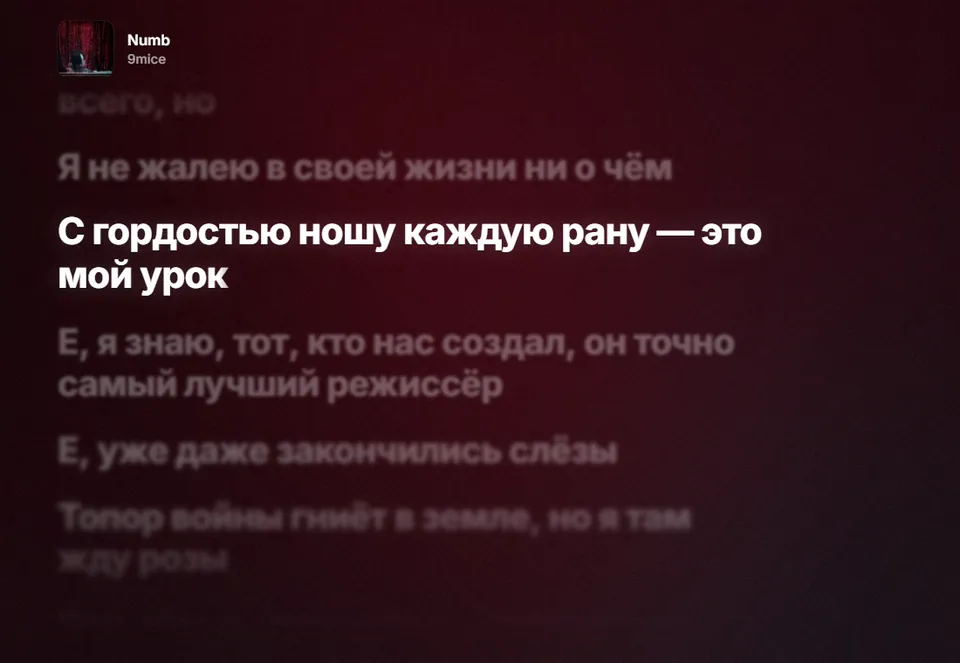
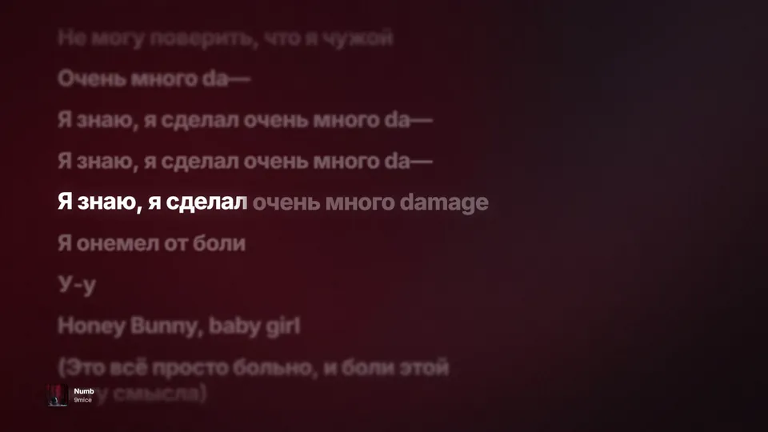
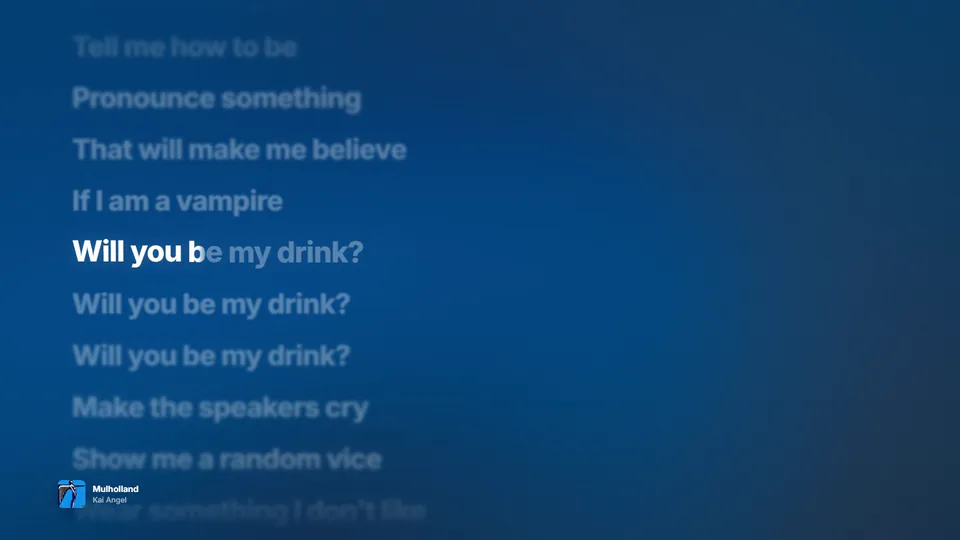
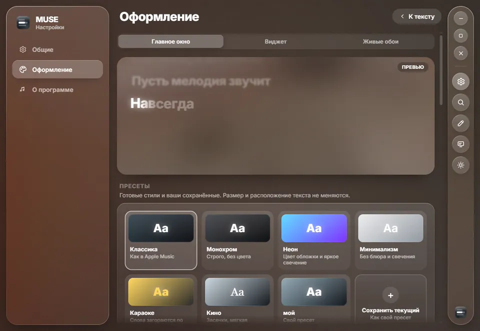
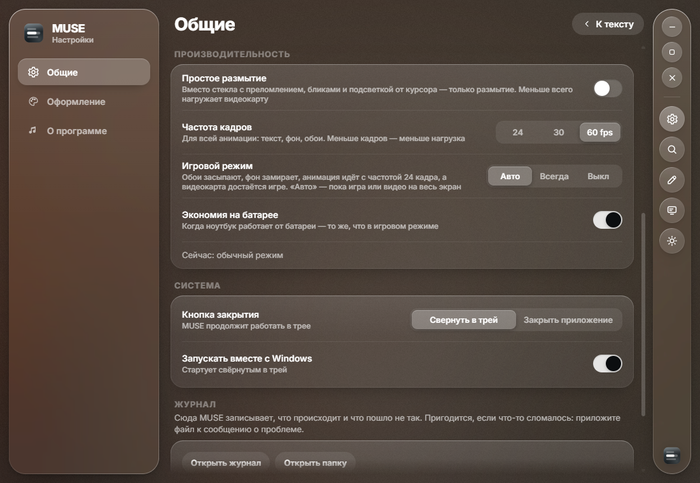
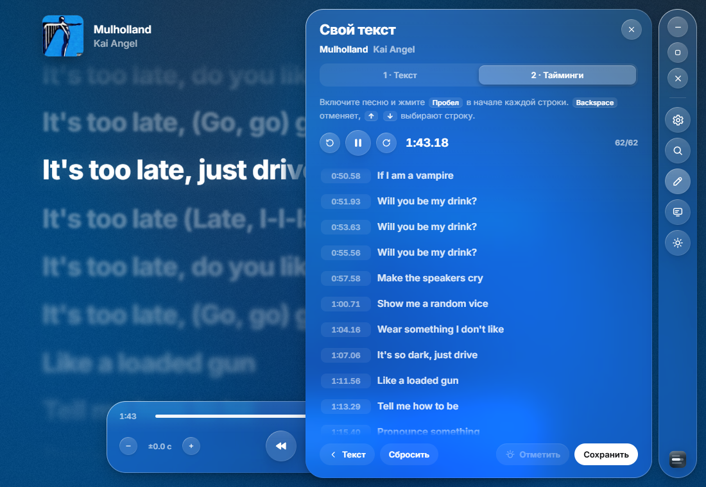

<p align="center">
  
</p>

<h3 align="center">Слова песни — там, где вы их видите</h3>

<p align="center">
  Синхронизированный текст для Windows в стиле Apple Music:<br>
  в окне, на рабочем столе и прямо вместо обоев.
</p>

<p align="center">
  <a href="https://github.com/yamete12345/muse/releases/latest"></a>
  &nbsp;
  
  &nbsp;
  <a href="https://github.com/yamete12345/muse/releases"></a>
</p>

<br>

<p align="center">
  
  <br><sub>9mice — Numb</sub>
</p>

<br>

MUSE слушает то же, что и вы. Spotify, Яндекс Музыка, Apple Music, YouTube Music в браузере, SoundCloud — любой плеер, который видят системные медиа-контролы Windows. Ничего не нужно настраивать: трек определяется сам, текст находится сам, а строки идут ровно в такт.

<table>
  <tr>
    <td width="33%" valign="top">
      <b>Как на iPhone</b><br>
      <sub>Слова заливаются светом по мере пения, соседние строки уходят в расфокус, текст прокручивается волной.</sub>
    </td>
    <td width="33%" valign="top">
      <b>Живые обои</b><br>
      <sub>Текст встраивается в слой обоев Windows: ярлыки поверх, клики проходят на рабочий стол.</sub>
    </td>
    <td width="33%" valign="top">
      <b>Фон из обложки</b><br>
      <sub>Цвета обложки медленно текут за текстом и чуть меняются местами на каждый удар музыки.</sub>
    </td>
  </tr>
  <tr>
    <td valign="top">
      <b>Сам находит текст</b><br>
      <sub>lrclib и Genius, оригинал для ремиксов и sped up, латиница для японских и корейских песен.</sub>
    </td>
    <td valign="top">
      <b>Любой плеер</b><br>
      <sub>Играет в нескольких местах — выбираете, что показывать, одним нажатием на обложку.</sub>
    </td>
    <td valign="top">
      <b>Не мешает играм</b><br>
      <sub>24, 30 или 60 кадров, а пока игра на весь экран — засыпает и отдаёт видеокарту.</sub>
    </td>
  </tr>
</table>

<br>

## Как в Apple Music

Активная строка светится, слова заливаются светом в такт голосу, на долгих нотах буквы приподнимаются по одной. Неактивные строки уходят в мягкий расфокус, а при смене строки всё полотно прокручивается волной. Над куплетами можно подписать, кто их поёт.

За текстом течёт обложка, растаявшая до своих цветов: большие области заливают экран, остальное вытягивается в мягкие мазки. На каждый удар музыки цвета чуть меняются местами, а при смене песни одни перетекают в другие. Для слабых видеокарт есть вариант полегче — размытая живая обложка.

<table>
  <tr>
    <td width="50%"></td>
    <td width="50%"></td>
  </tr>
  <tr>
    <td align="center"><sub>Тёмная тема</sub></td>
    <td align="center"><sub>Светлая тема</sub></td>
  </tr>
</table>

<br>

## Живые обои

Текст встраивается прямо в слой обоев Windows, как в Wallpaper Engine: ярлыки остаются поверх, клики проходят на рабочий стол. Можно включить на нескольких мониторах сразу — с общим оформлением или со своим для каждого. Под развёрнутыми окнами обои засыпают.

<p align="center">
  
  <br><sub>9mice — Numb</sub>
</p>

Если у песни нет текста, обложка перелетает из угла в центр экрана, а со следующей песней с текстом возвращается обратно. Обложки MUSE подтягивает в 1000 px из каталогов iTunes и Deezer, так что даже на 4K они не рассыпаются на пиксели.

<p align="center">
  
  <br><sub>Kai Angel — Mulholland</sub>
</p>

<br>

## Виджет

Стеклянная карточка на рабочем столе, под всеми окнами или поверх них: обложка, название и текст — несколькими строками или одной строкой, по которой бежит подсветка от слова к слову. Стекло бывает красивым (Windows размывает рабочий стол за виджетом, углы скругляются как угодно, а мутность — от чистого стекла до матового) или быстрым (только тонировка), а маленький эквалайзер у названия двигается в такт музыке. Если синхронного текста нет, в центре виджета остаётся обложка с названием и подсказкой, что текст можно открыть в приложении. Виджет можно перетащить, растянуть или поставить точно по схеме экрана в настройках, а при наведении появляются кнопки плеера.

<p align="center">
  
  <br><sub>Kai Angel — TV</sub>
</p>

<br>

## Чья это часть

Над куплетами и припевами — подпись, кто их поёт: «Куплет 2 · 9mice», «Припев · Kai Angel и 9mice». Разметку частей MUSE берёт с Genius и сама сопоставляет её с таймингами. По умолчанию подписываются дуэты и фиты, можно включить для всех песен.

<p align="center">
  
  <br><sub>Kai Angel — Flowers</sub>
</p>

<br>

## Оформление

Шрифт, жирность, выравнивание, цвет выделения (свой, из обложки или автоматический), сила размытия и свечения, способ заливки слов, характер прокрутки, фон. Шесть готовых пресетов — *Классика, Монохром, Неон, Минимализм, Караоке, Кино* — и свои, которые можно сохранить. Каждое изменение сразу видно в превью.

<p align="center">
  
</p>

Всё это на одной вкладке «Оформление», со страницей для главного окна, виджета и обоев. Виджет и обои можно сделать «как главное окно» — тогда своих настроек текста и фона у них нет вовсе, ничего не повторяется. Размер и расположение у каждого остаются свои.

<table>
  <tr>
    <td width="50%"></td>
    <td width="50%"></td>
  </tr>
  <tr>
    <td align="center"><sub>Живые обои: мониторы, расположение, своё оформление</sub></td>
    <td align="center"><sub>Виджет: слой, клики, расположение по схеме экрана</sub></td>
  </tr>
</table>

<br>

### Темы

Тема — это оформление главного окна, виджета и обоев в одном файле, иногда со своим стилем и своим фоном-шейдером. Тема ставится из `.zip` за пару кликов («Оформление → Темы»). Своё оформление сохраняется в тему одной кнопкой, и этим файлом можно поделиться. Как устроена тема и как сделать свою, описано в [docs/THEMES.md](docs/THEMES.md). Пример — тема [«Северное сияние»](docs/themes/aurora.zip).

## Не мешает играм

Вся анимация идёт с выбранной частотой — 24, 30 или 60 кадров, даже на мониторе 144 или 180 Гц. Пока игра или видео открыты на весь экран, включается **игровой режим**: обои засыпают, фон замирает, текст идёт с частотой 24 кадра, и видеокарта достаётся игре. Его же можно включить вручную из трея, а на ноутбуке то же самое происходит от батареи.

<table>
  <tr>
    <td width="55%"></td>
    <td width="45%" valign="top">
      <b>Нагрузка</b><br>
      <sub>Главное окно и живые обои на двух мониторах (один 4K), играет музыка, экран 180 Гц:</sub>
      <br><br>
      <table>
        <tr><td></td><td><sub>Процессор</sub></td><td><sub>Видеокарта</sub></td></tr>
        <tr><td><sub>60 кадров</sub></td><td><sub>~4%</sub></td><td><sub>~4%</sub></td></tr>
        <tr><td><sub>30 кадров</sub></td><td><sub>~2%</sub></td><td><sub>~2%</sub></td></tr>
        <tr><td><sub>Игровой режим</sub></td><td><sub>~1%</sub></td><td><sub>&lt;1%</sub></td></tr>
      </table>
    </td>
  </tr>
</table>

Для совсем слабых видеокарт есть «Простое размытие»: вместо стекла с преломлением и бликами — только размытие.

<br>

## Если текст не тот

Нашлась другая песня? Поиск по lrclib и Genius показывает варианты с пометками: синхронный ли текст, совпадает ли длина. Не нашлось ничего — текст можно написать самому и расставить тайминги, нажимая пробел в начале каждой строки.

<table>
  <tr>
    <td width="50%"></td>
    <td width="50%"></td>
  </tr>
  <tr>
    <td align="center"><sub>Поиск другого текста</sub></td>
    <td align="center"><sub>Свой текст и тайминги</sub></td>
  </tr>
</table>

<br>

## Что играет

Если музыка идёт сразу из нескольких мест — плеер, вкладка с YouTube, SoundCloud, — внизу правой панели появляются их обложки. Нажмите на обложку, и MUSE будет показывать это приложение, даже если параллельно играет видео или игра; повторное нажатие возвращает «что играет сейчас». То же есть в меню трея и на <kbd>Ctrl</kbd> <kbd>Alt</kbd> <kbd>S</kbd>.

Японские и корейские песни подписываются латиницей под строкой или вместо неё. Для японского MUSE один раз скачивает словарь чтений, около 12 МБ.

## Откуда текст

| | Источник | Что даёт |
| :-: | --- | --- |
| 1 | Ваш текст | написанный и размеченный прямо в MUSE |
| 2 | [lrclib.net](https://lrclib.net) | синхронизированный текст, иногда с таймингами по словам |
| 3 | [Genius](https://genius.com) | обычный текст и разметка частей песни |

Для ремиксов, sped up и slowed версий, которых нет в базах, MUSE берёт текст оригинала: у ускоренных и замедленных версий тайминги пересчитываются под их скорость, у ремиксов текст показывается без синхронизации.

Если текст спешит или опаздывает, сдвиг подстраивается кнопками в плеере или из трея и запоминается для каждой песни. Если отстаёт всё из одного приложения (часто это браузер), нажмите на значение сдвига: там есть отдельный сдвиг для приложения.

## Клавиши

| | |
| --- | --- |
| <kbd>Пробел</kbd> | пауза |
| <kbd>→</kbd> / <kbd>←</kbd> | следующий или предыдущий трек |
| <kbd>F11</kbd> | полный экран |
| <kbd>Esc</kbd> | вернуться из настроек к тексту |
| <kbd>Ctrl</kbd> <kbd>Alt</kbd> <kbd>L</kbd> | показать или спрятать окно — откуда угодно |
| <kbd>Ctrl</kbd> <kbd>Alt</kbd> <kbd>→</kbd> / <kbd>←</kbd> | следующий или предыдущий трек — откуда угодно |
| <kbd>Ctrl</kbd> <kbd>Alt</kbd> <kbd>]</kbd> / <kbd>[</kbd> | текст раньше или позже на 0,1 с |
| <kbd>Ctrl</kbd> <kbd>Alt</kbd> <kbd>S</kbd> | следующий источник музыки |

Крестик по умолчанию прячет MUSE в трей. В меню значка: что играет, переключение треков, сдвиг текста, «Текст неправильный…», источник, живые обои, виджет, игровой режим.

## Установка

1. Скачайте `MUSE_x.y.z_x64-setup.exe` со страницы [последней версии](https://github.com/yamete12345/muse/releases/latest).
2. Запустите установщик. Нужна Windows 10 или 11.
3. Включите музыку — MUSE подхватит её сама.

Дальше MUSE обновляется сама: когда выходит новая версия, появляется уведомление с кнопкой «Обновить». Проверить вручную можно в «Настройки → О программе». Если что-то пошло не так, приложите журнал («Настройки → Общие → Журнал») к [сообщению о проблеме](https://github.com/yamete12345/muse/issues/new).

## Приватность

MUSE не собирает и не отправляет никаких данных о вас. В сеть уходят только запросы текстов (lrclib, Genius) и обложек (iTunes, Deezer) по названию песни; найденное хранится в `%APPDATA%\com.muse.app`, и повторное прослушивание не ходит в сеть. Чтобы фон двигался в такт, MUSE слушает звук только того плеера, который показывает, и только пока фон виден: звук разбирается на ходу и нигде не записывается. Это выключается одним переключателем.

<br>

<details>
<summary><b>Сборка из исходников</b></summary>

<br>

Понадобятся Node 20+, Rust (MSVC) и Visual Studio Build Tools с компонентом «Разработка классических приложений на C++».

```bash
npm install
npm run tauri dev      # разработка
npm run tauri build    # установщик в src-tauri/target/release/bundle/nsis
```

Тесты:

```bash
npm test
cd src-tauri && cargo test
```

Релиз собирается сам: достаточно отправить метку версии с описанием изменений, например `git tag -a v0.5.0 -m "…" && git push origin v0.5.0`.

</details>

<details>
<summary><b>Как это устроено</b></summary>

<br>

Tauri 2: интерфейс на React и TypeScript, всё системное — на Rust.

```
src-tauri/src/
  media/gsmtc.rs        медиа-сессии Windows: трек, обложка, позиция
  media/artwork.rs      обложки в высоком качестве из iTunes и Deezer
  audio/                бит играющего приложения для фона
  power.rs              игра на весь экран и питание от батареи
  lyrics/               нормализация названий, lrclib, Genius, поиск, части песни, кэш
  widget.rs             виджет на рабочем столе
  glass.rs              стекло виджета: размытие Windows со скруглёнными углами
  themes.rs             темы: папка тем, проверка theme.json, установка и экспорт .zip
  wallpaper.rs          живые обои за ярлыками, по окну на монитор
  updater.rs            обновления с GitHub Releases с проверкой контрольной суммы
src/
  core/lyricsEngine.ts  анимация текста
  core/background.ts    WebGL-фон из цветов обложки
  core/ticker.ts        общий цикл кадров с ограничением частоты
  core/power.ts         игровой режим и экономия на батарее
  core/style.ts         модель оформления, связывание, пресеты
  components/Glass/     liquid glass через SVG-карту смещения
```

Вся анимация живёт в одном цикле кадров с выбранной частотой: между кадрами он спит, а бесконечные CSS-анимации (живая обложка, эквалайзер) идут по тем же часам, а не с частотой экрана. React строит разметку один раз на песню, а в кадре меняются только `transform` и CSS-переменные. Свёрнутые, спрятанные и закрытые другими окнами поверхности не анимируются вовсе.

</details>
