<p align="center">
  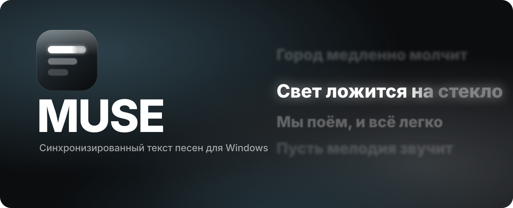
</p>

<p align="center">
  <i>Слова песни — там, где вы их видите.</i><br>
  <sub>Синхронизированный текст для Windows: в окне, на рабочем столе и вместо обоев.</sub>
</p>

<p align="center">
  <a href="https://github.com/yamete12345/muse/releases/latest"></a>
  
  
  
</p>

<br>

<p align="center">
  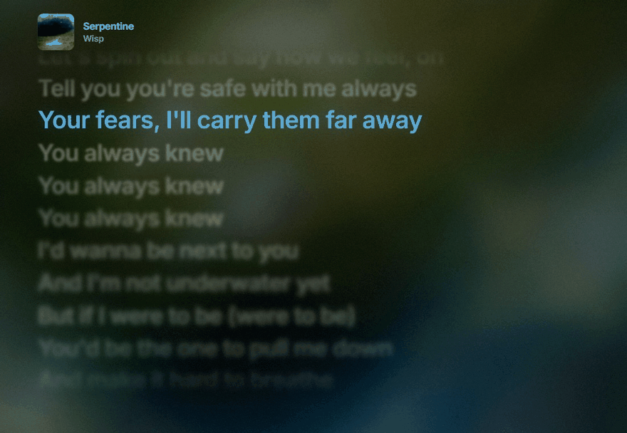
  <br><sub>Wisp — Serpentine</sub>
</p>

<br>

MUSE слушает то же, что и вы. Spotify, Яндекс Музыка, YouTube Music в браузере — любой плеер, который видят системные медиа-контролы Windows. Трек определяется сам, текст находится сам, а строки идут ровно в такт.

Выглядит это так, как привыкли на iPhone: активная строка светится, слова заливаются светом по мере пения, соседние строки уходят в мягкий расфокус, а всё полотно прокручивается волной. За текстом медленно течёт обложка, растаявшая до своих цветов: её большие области заливают экран, остальное вытягивается в мягкие мазки, а светлые места слегка вспыхивают в такт музыке. При смене песни одни цвета перетекают в другие. Для слабых видеокарт есть вариант полегче — размытая живая обложка.

<table>
  <tr>
    <td width="50%">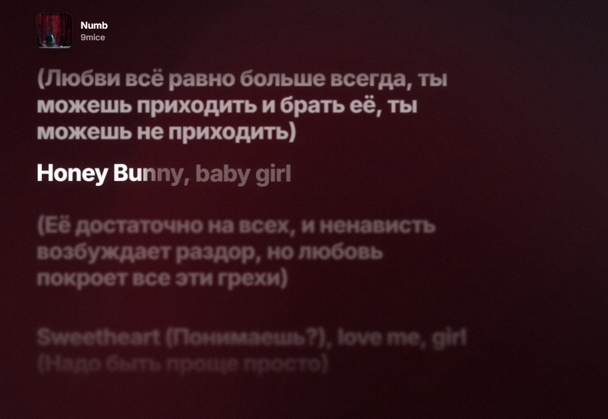</td>
    <td width="50%">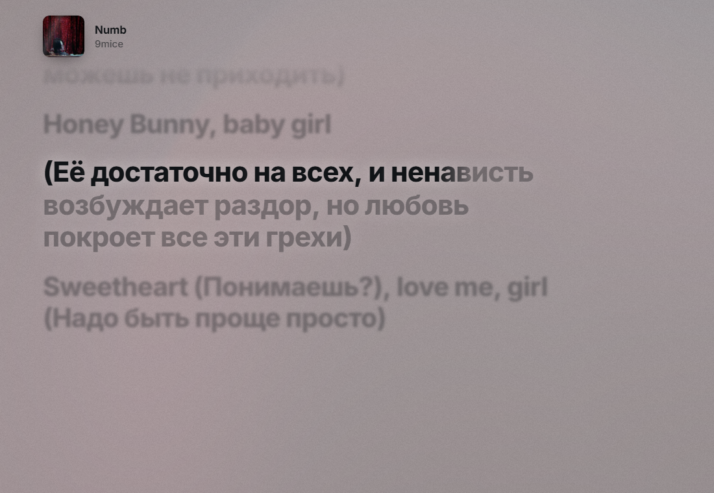</td>
  </tr>
  <tr>
    <td align="center"><sub>Тёмная тема</sub></td>
    <td align="center"><sub>Светлая тема</sub></td>
  </tr>
</table>

<br>

## Живые обои

Текст встраивается прямо в слой обоев Windows, как в Wallpaper Engine: ярлыки остаются поверх, клики проходят на рабочий стол. Можно включить на нескольких мониторах сразу — с общим оформлением или со своим для каждого. Анимация засыпает, когда рабочий стол закрыт развёрнутым окном, а если у песни нет текста, обложка плавно перелетает из угла в центр экрана и возвращается, когда следующая песня снова с текстом. Обложки MUSE подтягивает в высоком качестве из каталогов iTunes и Deezer, так что даже на 4K они не рассыпаются на пиксели.

<p align="center">
  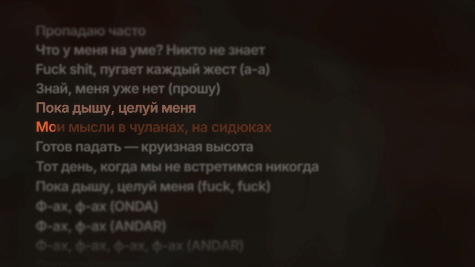
  <br><sub>onda andar — one way ticket</sub>
</p>

## Виджет

Прозрачная карточка на рабочем столе, под всеми окнами: обложка, название и несколько строк текста. Её можно перетащить, растянуть или поставить точно по схеме экрана в настройках.

<p align="center">
  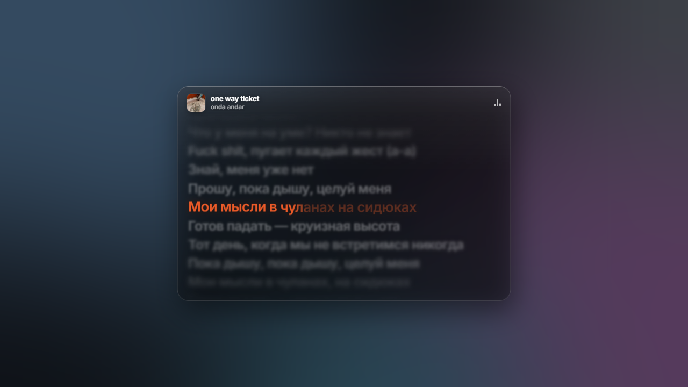
</p>

## Чья это часть

Над куплетами и припевами — подпись, кто их поёт: «Куплет 2 · 9mice», «Припев · Kai Angel и 9mice». Разметку частей MUSE берёт с Genius и сама сопоставляет её с таймингами. По умолчанию подписываются дуэты и фиты, можно включить для всех песен.

<p align="center">
  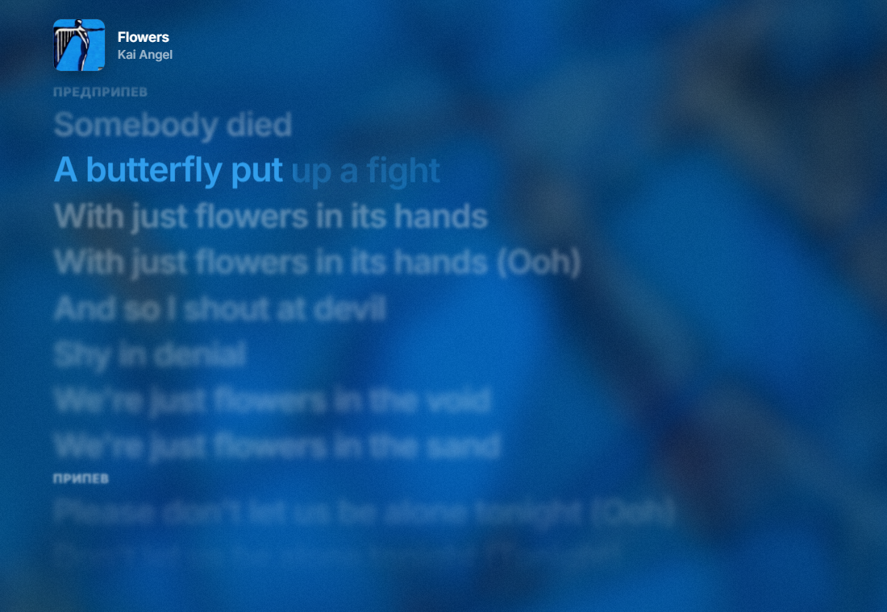
  <br><sub>Kai Angel — Flowers</sub>
</p>

## Оформление

Шрифт, жирность и выравнивание. Цвет выделения — свой, из обложки или автоматический. Сила размытия и свечения, способ заливки слов, характер прокрутки, фон. Всё это собрано на одной вкладке «Оформление»: виджет и обои можно связать с окном, и тогда у них одни общие настройки, без повторов, а можно настроить каждый отдельно. Размер текста и расположение у каждой поверхности свои, на её вкладке.

Шесть готовых пресетов: *Классика, Монохром, Неон, Минимализм, Караоке, Кино*. Понравившийся вариант можно сохранить как свой, а вернуть стандартный вид — одной кнопкой. Каждое изменение сразу видно в превью.

<p align="center">
  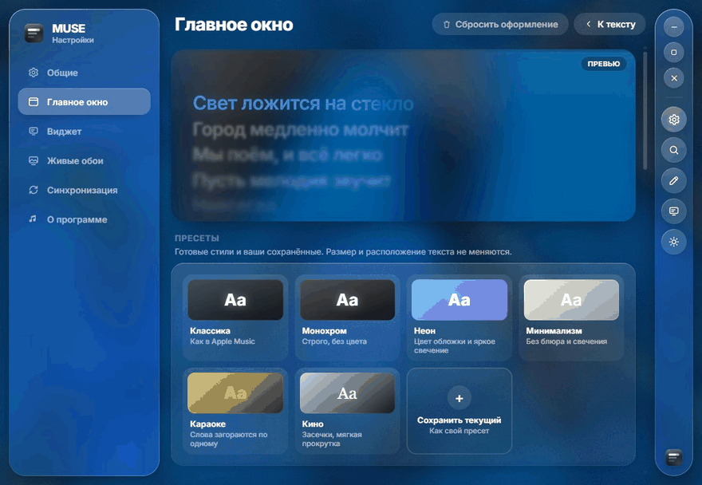
</p>

<table>
  <tr>
    <td width="50%">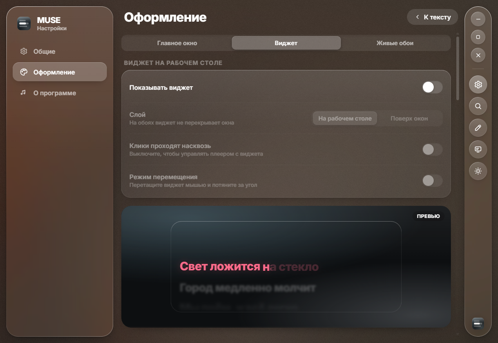</td>
    <td width="50%">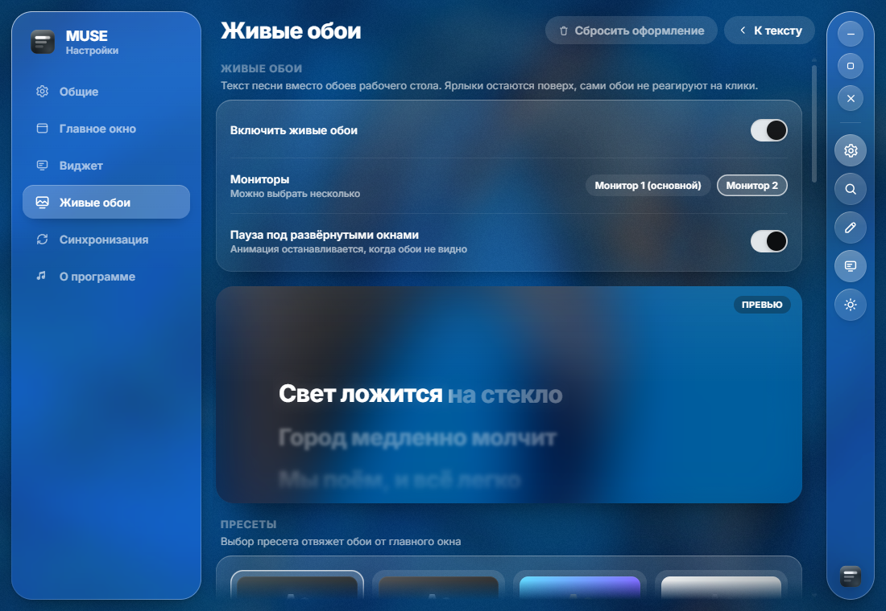</td>
  </tr>
  <tr>
    <td align="center"><sub>Виджет: расположение по схеме экрана</sub></td>
    <td align="center"><sub>Живые обои: мониторы и своё оформление</sub></td>
  </tr>
</table>

## Если текст не тот

Нашлась другая песня? Поиск по lrclib и Genius показывает варианты с пометками: синхронный ли текст, совпадает ли длина. Не нашлось ничего — текст можно написать самому и расставить тайминги, нажимая пробел в начале каждой строки.

<table>
  <tr>
    <td width="50%">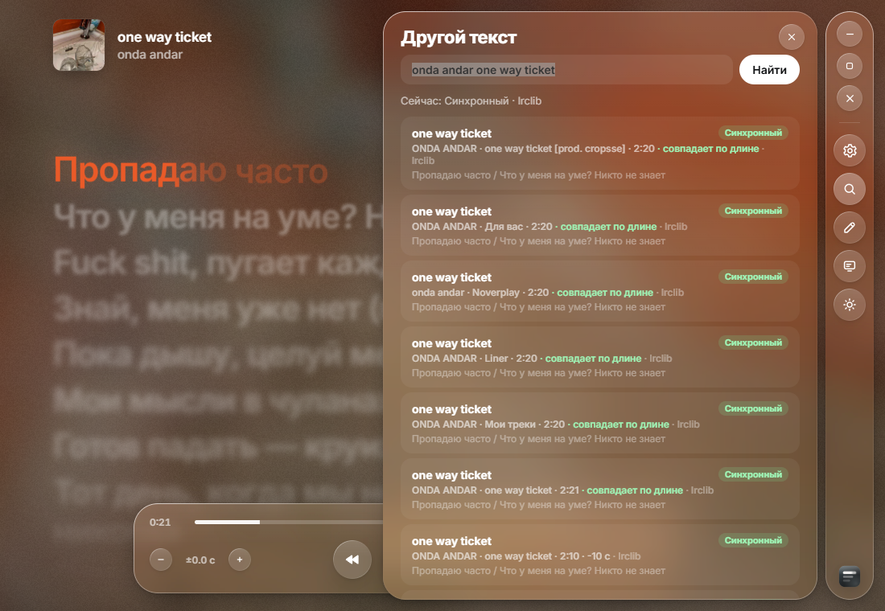</td>
    <td width="50%">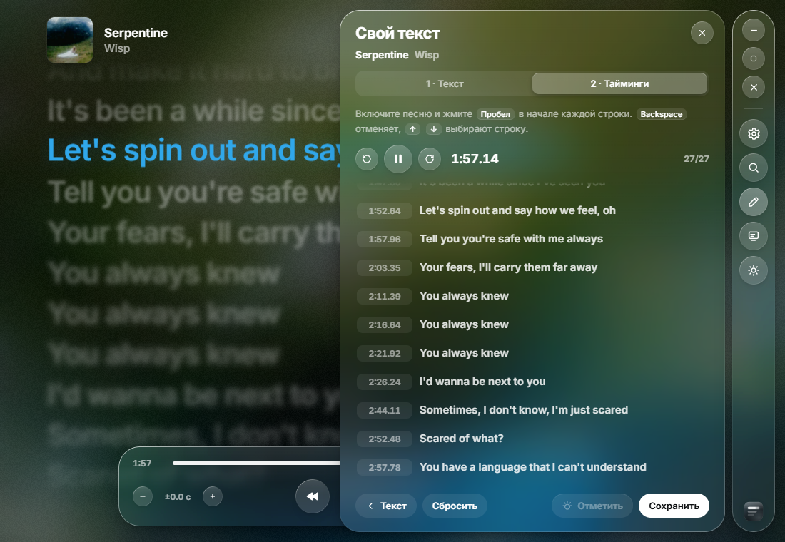</td>
  </tr>
  <tr>
    <td align="center"><sub>Поиск другого текста</sub></td>
    <td align="center"><sub>Свой текст и тайминги</sub></td>
  </tr>
</table>

## Что играет

Если музыка идёт сразу из нескольких мест — плеер, вкладка с YouTube, SoundCloud, — внизу правой панели появляются их обложки. Нажмите на обложку, и MUSE будет показывать это приложение, даже если параллельно играет видео или игра; повторное нажатие возвращает «что играет сейчас». То же есть в меню трея и на `Ctrl` `Alt` `S`.

Японские и корейские песни подписываются латиницей под строкой (или вместо неё). Для японского MUSE один раз скачивает словарь чтений, около 12 МБ.

## Откуда текст

| Порядок | Источник | Что даёт |
| :-: | --- | --- |
| 1 | Ваш текст | написанный и размеченный прямо в MUSE |
| 2 | [lrclib.net](https://lrclib.net) | синхронизированный текст, иногда с таймингами по словам |
| 3 | [Genius](https://genius.com) | обычный текст и разметка частей песни |

Для ремиксов, sped up и slowed версий, которых нет в базах, MUSE берёт текст оригинала: у ускоренных и замедленных версий тайминги пересчитываются под их скорость, у ремиксов текст показывается без синхронизации.

Найденное хранится в `%APPDATA%\com.muse.app`, повторное прослушивание не ходит в сеть. Если текст спешит или опаздывает, сдвиг подстраивается кнопками в плеере или из меню в трее и запоминается для каждой песни. Если отстаёт всё из одного приложения (часто это браузер), нажмите на значение сдвига в плеере: там есть отдельный сдвиг для приложения.

## Клавиши

| | |
| --- | --- |
| `Пробел` | пауза |
| `→` / `←` | следующий или предыдущий трек |
| `F11` | полный экран |
| `Ctrl` `Alt` `L` | показать или спрятать окно |
| `Ctrl` `Alt` `]` / `[` | текст раньше или позже на 0.1 с |
| `Ctrl` `Alt` `S` | следующий источник музыки |
| `Ctrl` `Alt` `→` / `←` | следующий или предыдущий трек, откуда угодно |
| `Esc` | вернуться из настроек к тексту |

Крестик по умолчанию прячет MUSE в трей — это меняется в настройках. В меню значка в трее: что играет, следующий и предыдущий трек, сдвиг текста, «Текст неправильный…», источник, живые обои, виджет и выход.

## Установка

Скачайте `MUSE_x.y.z_x64-setup.exe` со страницы [Releases](https://github.com/yamete12345/muse/releases/latest) и запустите. Нужна Windows 10 или 11.

Дальше MUSE обновляется сама: когда выходит новая версия, справа вверху появляется уведомление с кнопкой «Обновить». Проверить вручную можно в «Настройки → О программе».

Если что-то пошло не так, загляните в журнал: «Настройки → Общие → Журнал». Его стоит приложить к [сообщению о проблеме](https://github.com/yamete12345/muse/issues/new).

<details>
<summary><b>Сборка из исходников</b></summary>

<br>

Понадобятся Node 20+, Rust (MSVC) и Visual Studio Build Tools с компонентом «Разработка классических приложений на C++».

```bash
npm install
npm run tauri dev      # разработка
npm run tauri build    # установщик в src-tauri/target/release/bundle/nsis
```

Тесты:

```bash
npm test
cd src-tauri && cargo test
```

Новый релиз собирается сам: достаточно отправить метку версии с описанием изменений, например `git tag -a v0.3.0 -m "…" && git push origin v0.3.0`.

</details>

<details>
<summary><b>Как это устроено</b></summary>

<br>

```
src-tauri/src/
  media/gsmtc.rs        медиа-сессии Windows: трек, обложка, позиция
  audio/                бит играющего приложения для фона: слышит только его, ничего не пишет
  lyrics/               нормализация названий, lrclib, Genius, поиск, части песни, кэш
  widget.rs             виджет на рабочем столе
  wallpaper.rs          живые обои за ярлыками, по окну на монитор
  updater.rs            обновления с GitHub Releases с проверкой контрольной суммы
  logger.rs             журнал ошибок
src/
  core/lyricsEngine.ts  анимация текста на одном rAF-цикле
  core/parts.ts         сопоставление частей песни с таймингами
  core/background.ts    WebGL-фон в 1/6 разрешения, с ограничением fps
  core/style.ts         модель оформления, связывание, пресеты
  components/Glass/     liquid glass через SVG-карту смещения
```

Вся анимация живёт в одном `requestAnimationFrame`. React строит разметку один раз на песню, а в кадре меняются только `transform` и CSS-переменные. Свёрнутые, спрятанные и закрытые другими окнами поверхности не анимируются вовсе.

</details>
